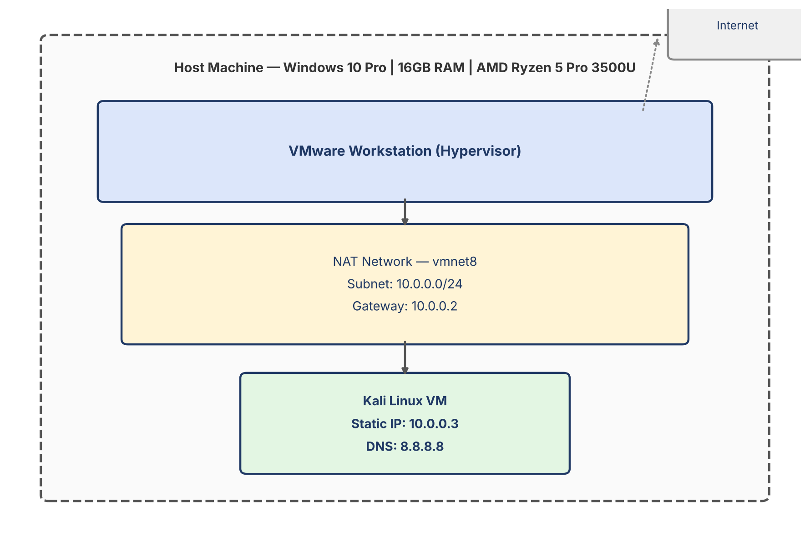
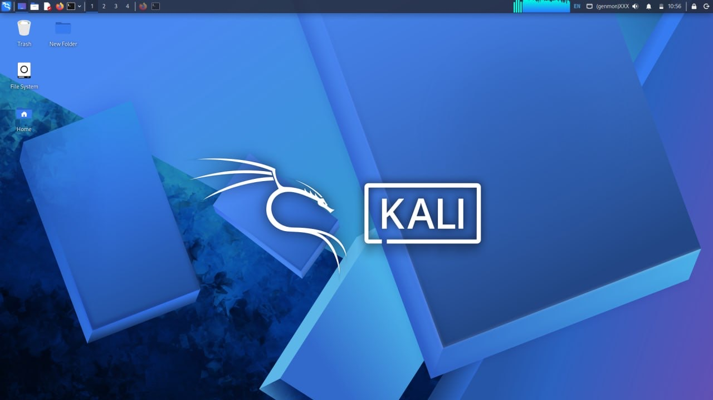
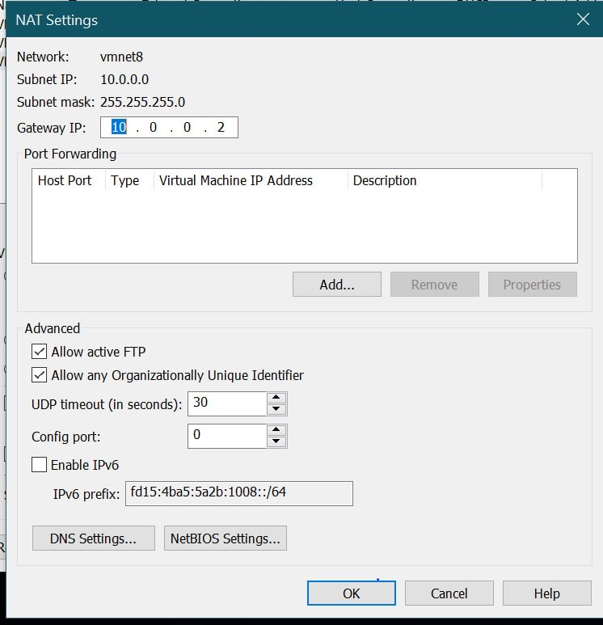
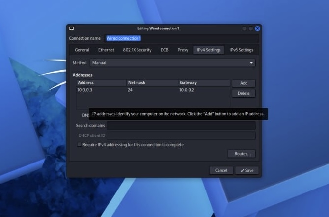

# Cybersecurity Lab Setup (VMware + Kali Linux)

Lab setup project documenting the build of an isolated penetration testing environment using VMware Workstation and Kali Linux, on a private NAT network.

## Project Overview

This lab runs on a fully isolated virtual network rather than a shared home network, so that any scanning, exploitation, or monitoring work stays contained to machines I own and control, with no risk to anything outside the lab.

## Objectives

- Install VMware Workstation as the hypervisor
- Import and configure Kali Linux as the primary attack machine
- Create an isolated NAT network for the lab
- Assign Kali a static IP on that network
- Verify connectivity (gateway, DNS, internet)
- Take a clean baseline snapshot before any testing begins

## Purpose of the Lab

This environment is intended for reconnaissance, vulnerability scanning, and exploitation practice against intentionally vulnerable targets I control. All testing is confined to this isolated network. No system outside this lab is ever scanned or targeted.

## Lab Architecture

The lab currently consists of one host machine (Windows 10 Pro) running VMware Workstation, with a single Kali Linux VM on an isolated NAT network. Additional target machines can be added to the same NAT network later without changing this base configuration.

## Lab Configuration

| Item | Value |
|---|---|
| Host OS | Windows 10 Pro |
| Host RAM | 16 GB |
| Host CPU | AMD Ryzen 5 Pro 3500U |
| Hypervisor | VMware Workstation |
| Network Mode | NAT (vmnet8) |
| Subnet | 10.0.0.0/24 |
| Subnet Mask | 255.255.255.0 |
| Gateway IP | 10.0.0.2 |
| Kali IP | 10.0.0.3 |

## Lab Setup Procedure

### Step 1: Install VMware Workstation
Installed VMware Workstation as the hypervisor on the Windows 10 Pro host.

### Step 2: Import Kali Linux
Imported the Kali Linux VM and confirmed the desktop environment loads cleanly.

### Step 3: Configure the NAT Network
VMware's default NAT network uses `vmnet8`, with the host side as the gateway. Set the gateway IP to **10.0.0.2** under NAT Settings, on the `10.0.0.0/24` subnet.

### Step 4: Assign Kali a Static IP
Configured Kali's wired connection with a manual IPv4 address of **10.0.0.3**, netmask `/24`, and gateway **10.0.0.2**, matching the NAT settings from Step 3.

### Step 5: Verify Connectivity
Confirmed Kali could reach the gateway and the internet from the assigned static IP.

### Step 6: Take a Baseline Snapshot
Took a clean snapshot of the Kali VM immediately after confirming connectivity, before any tools or testing activity, so the environment can always be restored to this known-good state.

## Lab Verification

| Test | Command | Expected Result |
|---|---|---|
| Confirm IP address | `ip a` | Kali shows 10.0.0.3 on the wired interface |
| Ping gateway | `ping -c 4 10.0.0.2` | Replies received, 0% packet loss |
| Ping internet | `ping -c 4 8.8.8.8` | Replies received, 0% packet loss |
| DNS resolution | `nslookup google.com` | Resolves to a valid IP |
| Snapshot restore | Revert to baseline snapshot in VMware | VM returns to clean, verified state |

### Example Results
IP Address: 10.0.0.3
Gateway: 10.0.0.2
DNS: 8.8.8.8

## Problems Encountered & Solutions

**Problem: Gateway/host addressing differs from VirtualBox**
The reference guide for this project was written for VirtualBox, where the NAT network gateway typically sits at `.1` and the guest is assigned `.2`. VMware Workstation's NAT network (vmnet8) reserves `.1` differently and places the gateway at `.2` instead. I adjusted accordingly, setting the gateway to **10.0.0.2** and assigning Kali **10.0.0.3**, keeping the same subnet logic as the guide while matching how VMware actually allocates the NAT addressing.

## What I Learned

1. NAT implementation details differ between hypervisors. The same networking concept (NAT) does not guarantee identical default addressing between VirtualBox and VMware, so configuration has to be verified against the actual tool in use, not assumed from a guide written for a different one.
2. Using a private NAT subnet (10.0.0.0/24) instead of my home network's address range keeps the lab cleanly isolated and avoids exposing details about my actual home network in documentation or screenshots.
3. Static IP configuration on the guest has to match the hypervisor's own gateway setting exactly, a mismatch here is a common source of lost connectivity.
4. Taking a snapshot immediately after a verified clean baseline, before any tool use or testing, is what makes an environment safely resettable.

## Security & Ethical Use

This lab exists strictly for personal learning and authorized testing within my own isolated environment. No system outside this lab is scanned, accessed, or tested.

## Tools & Resources

- [VMware Workstation](https://www.vmware.com/products/workstation-pro.html)
- [Kali Linux](https://www.kali.org/get-kali/)

## Author

Tunde Oduola
[LinkedIn](https://www.linkedin.com/in/tunde-oduola-2855a5239)

## Project Information

- **Internship/Program:** NetworkWalks, Cybersecurity and Ethical Hacking Class
- **Week:** 1
- **Project:** Cybersecurity Lab Setup
- **Organization:** NetworkWalks
- **Repository Name:** NETWORKWALKS-TUNDE-B084-WK1-PM1-CYBERSECURITY-LAB-SETUP
- **Repository Type:** Public
